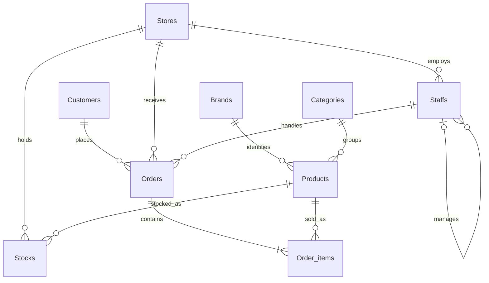

# BikeStore | Retail Sales & Inventory Intelligence

### Turning retail transactions into measurable performance and smarter operational decisions.

A **Microsoft SQL Server (T-SQL)** analytics project built with the BikeStores sample dataset. The project connects customer, sales, product, staff, and inventory data in a relational database, then delivers reusable reporting through **7 SQL views** and **5 parameterized stored procedures**.

**The focus:** not just writing SQL queries, but making everyday retail questions easier to answer—from which stores generate revenue to which products need replenishment.

    

📊 **Project presentation:** [BikeStore_Presentation.pdf](BikeStore_Presentation.pdf)

---

## At a Glance

| Business area | Question answered | SQL deliverable |
|---|---|---|
| Store performance | Which stores produce the most revenue and orders? | Store summary view and store KPI procedure |
| Product performance | Which products and categories drive sales? | Product ranking and category views; product procedure |
| Inventory | What is out of stock or running low at each store? | Inventory view and restock procedure |
| People & geography | How do staff and store locations compare? | Staff and regional performance views |
| Sales trends | How does revenue change by month or year? | Monthly trend view and year-comparison procedure |
| Customer behavior | What does a specific customer buy and spend? | Customer profile procedure |

## 1. The Business Challenge

A retail business can have thousands of transactions and still struggle to answer simple management questions quickly. Order lines, stock quantities, product details, and employee assignments sit in separate tables. Without a reusable analytical layer, the same calculations must be rebuilt whenever a decision is needed.

**Project objective:** bring these datasets together in SQL Server and create repeatable, business-oriented outputs for sales monitoring, inventory control, and performance comparisons.

```text
9 CSV files  →  Relational SQL database  →  7 reusable views
                                         →  5 targeted procedures
                                         →  KPIs & business decisions
```

## 2. Dataset & Data Model

The project uses the **BikeStores sample retail dataset**, supplied as nine CSV files. The counts below describe the uploaded source files, excluding headers.

| Table | Records | What it represents |
|---|---:|---|
| `Customers` | 1,445 | Customer identities and contact/location fields |
| `Stores` | 3 | Retail locations |
| `Staffs` | 10 | Employees, store assignments, and reporting lines |
| `Orders` | 1,615 | Customer orders, dates, statuses, stores, and staff |
| `Order_items` | 4,722 | Product-level quantities, prices, and discounts |
| `Products` | 321 | Bicycle catalog, brands, categories, and model years |
| `Categories` | 7 | Product category labels |
| `Brands` | 9 | Bicycle brands |
| `Stocks` | 939 | Quantity available for each store/product combination |
| **Total** | **9,071** | **Rows across all source CSVs** |

### Relationships



**Design details:** primary keys identify records; foreign keys connect orders to customers, stores, and staff, and products to brands and categories. `Order_items` has a composite primary key (`order_id`, `item_id`), while `Stocks` uses (`store_id`, `product_id`). The `Staffs.manager_id` field references `Staffs.staff_id`, representing a manager hierarchy.

> **Data notes:** Some source fields are missing, including customer phone numbers and order shipping dates. This project uses the supplied sample data; it is not a live retail reporting system.

## 3. KPI Definitions

The analytical objects calculate the following metrics directly from order and inventory records:

| Metric | Calculation / interpretation |
|---|---|
| **Net sales revenue** | `SUM(quantity * list_price * (1 - discount))` |
| **Orders** | `COUNT(DISTINCT order_id)` |
| **Units sold** | `SUM(quantity)` |
| **Average order value (AOV)** | Revenue / distinct order count |
| **Product sales rank** | `DENSE_RANK()` by product revenue, descending |
| **Out of stock** | `quantity = 0` |
| **Low stock** | `quantity < 10` and greater than zero |

**Interpretation:** “Revenue” here means discounted sales value from order items. It is **not net profit**: product acquisition costs, operating expenses, and returns are not included in these calculations. The SQL views also do not filter orders by fulfillment status, so the results reflect the rows included in the source order data.

## 4. Reusable Analytics: Seven Views

Views provide consistent metrics without rewriting the same joins and aggregations for every report.

| SQL view | What it delivers | Business use |
|---|---|---|
| `vw_StoreSalesSummary` | Revenue, distinct orders, AOV by store | Compare store productivity |
| `vw_TopSellingProducts` | Product revenue and `DENSE_RANK()` | Identify leading products |
| `vw_InventoryStatus` | Store/product quantities and stock labels | Spot potential stockouts |
| `vw_StaffPerformance` | Orders and revenue attributed to staff | Compare sales handling performance |
| `vw_RegionalTrends` | Revenue and orders by store state/city | Evaluate geographic differences |
| `vw_SalesByCategory` | Units sold and revenue by category | Understand product mix |
| `vw_MonthlySalesTrend` | Monthly order count, units, and revenue | Monitor seasonality and trends |

**Example — store performance**

```sql
SELECT *
FROM vw_StoreSalesSummary
ORDER BY Revenue DESC;
```

**Example — product ranking**

```sql
SELECT TOP (10) product_name, Total_Sales, Sales_Rank
FROM vw_TopSellingProducts
ORDER BY Sales_Rank, product_name;
```

> **Implementation detail:** In the supplied `vw_InventoryStatus` definition, the `CASE` expression labels only out-of-stock and low-stock products; rows with quantity **10 or more** remain in the view with `NULL` as `Stock_status`. The restock procedure below filters to quantities under 10.

## 5. On-Demand Analysis: Five Stored Procedures

Parameterized procedures let an analyst request a specific store, product, customer, or comparison period.

| Procedure | Parameters | Result |
|---|---|---|
| `sp_CalculateStoreKPI` | `@store_id` | Store revenue, orders, units sold |
| `sp_GenerateRestockList` | `@store_id` | Products with stock below 10 at a selected store |
| `sp_CompareSalesYearOverYear` | `@year1`, `@year2` | Revenue grouped by each selected year |
| `sp_GetCustomerProfile` | `@customer_id` | Customer spend and orders, plus a separate top-purchased-product result |
| `sp_GetProductPerformance` | `@product_id` | Units sold, orders, revenue, average discounted item price |

**Example — investigate a specific store**

```sql
EXEC sp_CalculateStoreKPI @store_id = 3;
EXEC sp_GenerateRestockList @store_id = 3;
```

**Example — compare two years**

```sql
EXEC sp_CompareSalesYearOverYear
    @year1 = 2016,
    @year2 = 2018;
```

**Example — customer and product drill-down**

```sql
EXEC sp_GetCustomerProfile @customer_id = 250;
EXEC sp_GetProductPerformance @product_id = 10;
```

**Scope note:** `sp_CompareSalesYearOverYear` returns annual revenue rows; it does **not** calculate a percentage growth column. The product procedure's average selling price uses `AVG(list_price * (1 - discount))` across item rows, rather than a quantity-weighted average.

## 6. From Insights to Decisions

The presentation frames the project around five practical areas for investigation. These are **analytical opportunities**, not claims that a specific store, employee, or product has been proven to underperform without examining the query outputs.

| Signal to investigate | Management action to consider |
|---|---|
| Products below the stock threshold | Prioritize replenishment to reduce potential lost sales |
| Stores with relatively low orders or revenue | Investigate demand, product mix, and operating conditions |
| Products with relatively low sales | Review pricing, assortment, and promotion strategy |
| Differences in staff performance | Investigate workflows and share effective practices |
| Differences between store locations | Adapt inventory allocation and local sales strategies |

**Key takeaway:** the project moves from descriptive reporting (“what happened?”) toward operational questions (“where should we investigate or act?”). Its outputs support decisions; they do not independently prove why a performance gap exists.

## 7. Project Files

Recommended GitHub repository layout:

```text
BikeStore/
├── README.md
├── BikeStore.sql
├── BikeStore_Presentation.pdf
└── csv-files-cleaned/
    ├── brands.csv
    ├── categories.csv
    ├── customers.csv
    ├── order_items.csv
    ├── orders.csv
    ├── products.csv
    ├── staffs.csv
    ├── stocks.csv
    └── stores.csv
```

> Adjust the paths and presentation link if your actual GitHub folder structure is different.

## 8. Reproduce the Project

**Requirements:** Microsoft SQL Server, SQL Server Management Studio (SSMS), and access to the nine CSV files from this repository.

1. Download or clone the repository.
2. Put the nine CSV files in a folder accessible to the **SQL Server service** (not just the SSMS client).
3. Open `BikeStore.sql` and replace the existing local Windows paths in all `BULK INSERT` statements with the location of your CSV files.
4. Execute the database and table creation statements, followed by the data imports, in the order given in the script.
5. Execute each `CREATE VIEW` and `CREATE PROCEDURE` definition in its **own SQL Server batch** (for example, add `GO` separators between definitions). In SQL Server, `CREATE VIEW` and `CREATE PROCEDURE` must begin their respective batches; the uploaded script does not consistently separate them.
6. Run the example `SELECT` and `EXEC` statements to inspect the analytical outputs.

**Important:** The script creates the `BikeStore` database and imports records. It is designed for an initially empty database; rerunning it unchanged can cause object-already-exists or duplicate-key errors. The original CSV files and SQL script should be treated as source assets, not a one-click production deployment.

## 9. Technical Skills Demonstrated

- **Relational modeling:** primary/foreign keys, composite keys, and self-referencing relationships.
- **Data ingestion:** `BULK INSERT` from nine CSV datasets and `IDENTITY_INSERT` for source IDs.
- **Multi-table analysis:** `INNER JOIN` across sales, customers, products, stores, and staff.
- **Aggregations:** `SUM`, `COUNT(DISTINCT ...)`, `GROUP BY`, and revenue/AOV calculations.
- **Window functions:** `DENSE_RANK()` for product performance ranking.
- **Conditional logic:** `CASE` expressions for inventory status.
- **Reusable SQL:** seven views and five parameterized stored procedures.
- **Time-based reporting:** `YEAR()` and `MONTH()` for sales trends and comparisons.
- **Business translation:** connecting SQL results to inventory, assortment, and performance decisions.

## 10. Next Iterations

The presentation proposes a longer-term progression beyond the current SQL implementation:

1. **Power BI dashboards:** connect reporting views to interactive sales and inventory visuals.
2. **Smarter inventory:** replace a fixed restock threshold with demand-aware reorder logic.
3. **Margin analysis:** introduce product cost/COGS data to measure profit rather than revenue alone.
4. **Sales forecasting:** use historical demand to explore future sales and inventory needs.

These are **future enhancements**, not features already implemented in the supplied SQL script.

## Author

**Javohir Yunusov**  
Data Analyst | SQL · Python · Power BI · Business Analytics  
[LinkedIn](https://www.linkedin.com/in/javohir-yunusov-705424295)

---

*Portfolio project based on the BikeStores sample dataset. SQL results and recommendations are for educational and analytical purposes.*
